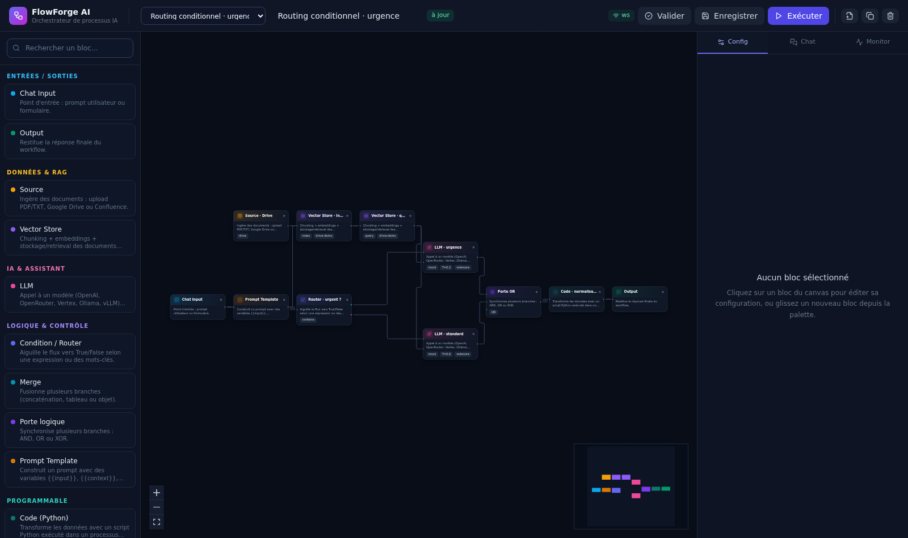

# FlowForge AI — Orchestrateur de processus IA en drag-and-drop

Prototype complet d'une application web (inspirée de **n8n** et **Flowise**) pour concevoir,
exécuter et monitorer des workflows IA : **LLM**, **RAG**, **logique conditionnelle** et **code Python personnalisé**,
le tout dans un canvas React Flow relié à un moteur d'exécution
asynchrone FastAPI avec **streaming des tokens en WebSocket**.



---

## Sommaire

1. [Fonctionnalités](#1-fonctionnalités)
2. [Stack technique](#2-stack-technique)
3. [Démarrage rapide](#3-démarrage-rapide)
4. [Architecture](#4-architecture)
5. [Catalogue des blocs](#5-catalogue-des-blocs)
6. [Moteur d'exécution](#6-moteur-dexécution)
7. [Protocole WebSocket](#7-protocole-websocket)
8. [API REST](#8-api-rest)
9. [Connecteurs & RAG](#9-connecteurs--rag)
10. [Monitoring & debug](#10-monitoring--debug)
11. [Configuration (`.env`)](#11-configuration-env)
12. [Tests](#12-tests)
13. [Structure du projet](#13-structure-du-projet)
14. [Limites connues & feuille de route](#14-limites-connues--feuille-de-route)

---

## 1. Fonctionnalités

| Domaine                    | Ce qui est implémenté                                                                                                                                                                                                                                        |
|----------------------------|--------------------------------------------------------------------------------------------------------------------------------------------------------------------------------------------------------------------------------------------------------------|
| **Éditeur visuel**         | Canvas React Flow (zoom, minimap, contrôles), palette de blocs drag-and-drop, câblage par handles, panneau de configuration dynamique par type de bloc, renommage, duplication, suppression, validation du DAG.                                              |
| **Ingestion documentaire** | Upload PDF/TXT/MD/CSV (extraction texte via `pypdf`, limite configurable de 100 Mo), connecteur **Google Drive** (service account) et **Confluence Atlassian** (REST v2, Basic auth), avec repli automatique sur un jeu de documents de démonstration. |
| **RAG**                    | Chunking paramétrable (taille + recouvrement), embeddings par lots (OpenAI ou fallback local déterministe), vector store persistant JSON avec similarité cosinus + top-K, mode *index* et mode *query* dans un seul bloc.                         |
| **LLM**                    | Couche unifiée **OpenAI / OpenRouter / Vertex AI (Gemini) / Ollama / vLLM / Mock**. System Prompt (personnalisable ou par défaut), température, max tokens, mémoire conversationnelle fenêtrée, streaming token par token, estimation des tokens et du coût. |
| **Logique**                | Router True/False (expression Python, mots-clés, regex), portes **AND / OR / XOR / NAND**, **Merge** (concat / tableau / objet / premier), **Prompt Template** avec variables.                                                                               |
| **Programmable**           | **Code Node** Python exécuté dans un sous-processus isolé (`python -I`), avec timeout et capture d'erreurs.                                                                                                                                                  |
| **Moteur**                 | Traduction JSON → DAG, détection de cycles, exécution **niveau par niveau** avec parallélisme intra-niveau, propagation sélective des branches (`skipped`), agrégation des tokens/coûts.                                                                     |
| **Monitoring**             | Panneau live : statut par bloc, latence, tokens, coût estimé, payloads d'entrée/sortie, métadonnées, sortie finale, historique des exécutions consultable.                                                                                                   |
| **Chat de test**           | Chat UI avec streaming en direct, overrides de provider/modèle, mémoire conversationnelle côté serveur.                                                                                                                                                      |

Captures : [canvas](docs/screen-canvas.png) · [configuration LLM](docs/screen-config.png) ·
[chat + streaming](docs/screen-chat.png) · [monitor](docs/screen-monitor.png)

---

## 2. Stack technique

**Frontend** — React 18 + TypeScript, Vite, Tailwind CSS, `@xyflow/react` (React Flow 12),
Zustand (état), Lucide (icônes).

**Backend** — Python 3.12, FastAPI, Uvicorn, Pydantic v2, httpx (streaming SSE vers les
providers LLM), pypdf. Persistance sur fichiers JSON (workflows, runs, vecteurs) — remplaçable
par PostgreSQL/pgvector sans toucher au moteur.

**Communication** — REST (`/api/*`) + WebSockets (`/ws/workflows/{id}`, `/ws/runs/{id}`).

---

## 3. Démarrage rapide

### Option A — Docker Compose (recommandé)

```bash
cp .env.example .env          # optionnel : ajoutez vos clés API
docker compose up --build
```

- Frontend : <http://localhost:5173>
- API + docs OpenAPI : <http://localhost:8000/docs>

### Option B — Développement local

```bash
# 1. Backend
cd backend
python -m venv .venv && source .venv/bin/activate
pip install -r requirements.txt
uvicorn app.main:app --reload --port 8000

# 2. Frontend (autre terminal)
cd frontend
npm install
npm run dev        # http://localhost:5173 — proxy /api et /ws vers :8000
```

> **Aucune clé API n'est nécessaire pour démarrer.** Le provider par défaut `mock`
> simule un LLM (streaming token par token, latence, tokens) afin de dérouler toute la
> chaîne — y compris le RAG — hors ligne. Deux workflows de démonstration sont créés
> automatiquement au premier lancement.

### Parcours de découverte (2 minutes)

1. Ouvrir le workflow **« Routing conditionnel · urgence »**.
2. Onglet **Chat** → envoyer *« Incident urgent en production »* → observer les tokens
   arriver en streaming, le canvas s'animer et la branche `False` du routeur passer en `skipped`.
3. Onglet **Monitor** → déplier le nœud LLM : latence, tokens, coût, payloads entrée/sortie.
4. Glisser un bloc **Code (Python)** depuis la palette, le câbler, l'exécuter.
5. Bascher sur le workflow **« RAG · Confluence + Vector Store »** pour voir ingestion →
   chunking → retrieval → génération.

---

## 4. Architecture

```
┌──────────────────────────── Frontend (React + TS) ────────────────────────────┐
│  TopBar · NodePalette · FlowCanvas (React Flow) · ConfigPanel                 │
│                                              ChatPanel · DebugPanel           │
│                       Zustand store  ◄──── événements ────┐                   │
└───────────────────────────┬───────────────────────────────┼───────────────────┘
                            │ REST /api/*                    │ WebSocket /ws/*
┌───────────────────────────▼───────────────────────────────┴───────────────────┐
│                              FastAPI (backend)                                │
│  api/routes.py ── workflows · sources · vectorstores · executions · providers  │
│  api/ws.py ───── ConnectionManager (rooms workflow:{id} / run:{id})           │
│                                                                               │
│  engine/executor.py   GraphExecutor  (niveaux, parallélisme, skip, métriques)  │
│  engine/graph.py      compile_graph  (validation DAG, Kahn, cycles, niveaux)   │
│  engine/registry.py   catalogue + fabrique de nœuds                            │
│  engine/nodes/*       io · sources · rag · llm · logic · code                  │
│                                                                               │
│  services/llm.py          providers unifiés + streaming SSE + coûts            │
│  services/embeddings.py   OpenAI | hashing local                               │
│  services/vectorstore.py  chunks + cosinus + persistance JSON                  │
│  services/connectors/*    Google Drive · Confluence                            │
│  services/storage.py      workflows & runs (JSON)                              │
└───────────────────────────────────────────────────────────────────────────────┘
```

**Flux d'une exécution**

```
Chat UI ──POST /api/workflows/{id}/run──► GraphExecutor
   ▲                                        │ compile_graph(JSON → DAG)
   │  node.started / node.token /           │ pour chaque niveau : asyncio.gather(...)
   │  node.finished / run.finished          │ propagation payload selon handles actifs
   └────────── WebSocket ───────────────────┘
```

---

## 5. Catalogue des blocs

| Type (`type`) | Catégorie    | Handles entrée → sortie        | Rôle                                                                            |
|---------------|--------------|--------------------------------|---------------------------------------------------------------------------------|
| `input`       | I/O          | — → `output`                   | Point d'entrée utilisateur (champ du payload, placeholder du chat).             |
| `output`      | I/O          | `input` → —                    | Restitue la réponse finale (`text` ou `json`), alimente le chat.                |
| `source`      | Données      | — → `output`                   | Ingestion : texte inline, fichiers uploadés, Google Drive, Confluence.          |
| `vectorStore` | Données      | `input` → `output`             | Mode **index** (chunking + embeddings + store) ou **query** (top-K + contexte). |
| `llm`         | IA           | `prompt`, `context` → `output` | Provider + modèle, System Prompt, température, max tokens, mémoire, streaming.  |
| `condition`   | Logique      | `input` → `true` / `false`     | Aiguillage par expression Python, mots-clés ou regex.                           |
| `logicGate`   | Logique      | `input1..3` → `output`         | Synchronisation AND / OR / XOR / NAND.                                          |
| `merge`       | Logique      | `input1..3` → `output`         | Fusion concat / tableau / objet / premier.                                      |
| `template`    | Logique      | `input` → `output`             | Prompt Template avec variables `{{text}}`, `{{context}}`, `{{prompt}}`.         |
| `code`        | Programmable | `input` → `output`             | Script Python isolé (`payload`, `context`, `result`).                           |

Le catalogue est **décrit par le backend** (`GET /api/node-types`) : la palette et le panneau
de configuration du frontend sont générés à partir de cette description, donc ajouter un bloc
côté serveur suffit à le rendre disponible dans l'UI.

---

## 6. Moteur d'exécution

`backend/app/engine/executor.py`

1. **Compilation** — `compile_graph()` transforme le JSON React Flow en DAG :

   ```python
   nodes: dict[str, FlowNode]
   incoming / outgoing: dict[str, list[FlowEdge]]
   levels: list[list[str]]        # tri topologique en niveaux (Kahn)
   ```

   Erreurs explicites : arête orpheline, boucle sur soi, **cycle détecté** (liste des nœuds
   concernés), workflow vide, ids dupliqués.

2. **Exécution par niveau** — les nœuds d'un même niveau sont lancés en parallèle (`asyncio.gather`), ce qui exploite
   naturellement les branches indépendantes (ex. indexation Confluence ∥ saisie du prompt).

3. **Déclenchement sélectif** (`trigger_handles`) — un nœud ne s'exécute que si un de ses *handles déclencheurs* a reçu
   une donnée. Le bloc `llm` est déclenché par `prompt` ;
   son handle `context` est un apport optionnel qui ne le lance pas seul. Un handle non câblé
   est ignoré (robustesse).

4. **Propagation & branches mortes** — un `Condition` renvoie `active_handles=['true']` ou
   `['false']` : seules les arêtes correspondantes reçoivent le payload. Les nœuds en aval
   non atteints sont marqués **`skipped`** (« Branche non empruntée »), pas « error ».

5. **Erreurs** — le premier nœud en échec fait basculer le run en `error`, les nœuds restants
   sont marqués `skipped` avec la raison, et le message remonte jusqu'au chat.

6. **Métriques** — chaque nœud expose `latencyMs`, `promptTokens`, `completionTokens`,
   `totalTokens`, `costUsd`, `input`, `output`, `meta` ; le run agrège durées, tokens et coûts.

7. **Mémoire conversationnelle** — `ConversationMemory` (RAM, fenêtrée) est injectée dans les
   messages du nœud LLM ; le chat peut la purger via `DELETE /api/conversations/{id}`.

> **Sécurité du Code Node** : exécution dans un sous-processus `python -I` avec timeout et
> capture `traceback`. Ce n'est **pas** un bac à sable de sécurité. En production : conteneur
> sans réseau, utilisateur non-root, gVisor/Firecracker ou un service d'exécution dédié.

---

## 7. Protocole WebSocket

`ws://<hôte>/ws/workflows/{workflowId}` — canal d'exécution du workflow.

**Client → serveur**

```json
{
  "action": "run",
  "input": {
    "prompt": "Ma question"
  },
  "conversationId": "conv_abc",
  "provider": "openai",
  // optionnel (override)
  "model": "gpt-4o-mini"
}     // optionnel
```

**Serveur → client** (chaque événement porte `type`, `runId`, `ts`)

| `type`                        | `data`                       | Usage UI                                                 |
|-------------------------------|------------------------------|----------------------------------------------------------|
| `connected`                   | `room`                       | handshake                                                |
| `run.started`                 | `Execution`                  | reset des statuts, remise à zéro des arêtes              |
| `node.started`                | `NodeUsage`                  | nœud en cours (pulse)                                    |
| `node.token`                  | `{ token }`                  | **streaming** : concaténé dans le chat + panneau monitor |
| `node.finished`               | `NodeUsage`                  | statut, latence, tokens, coût, erreur                    |
| `edge.active`                 | `{ edgeId, source, target }` | arête animée                                             |
| `run.finished` / `run.failed` | `Execution`                  | synthèse finale (tokens, coût, durée)                    |
| `error`                       | `{ error }`                  | erreur globale (graphe invalide, etc.)                   |

`ws://<hôte>/ws/runs/{runId}` permet d'observer une exécution déjà lancée (replay du dernier
état + diffusion live) — utile pour un onglet de monitoring détaché.

---

## 8. API REST

| Méthode & chemin                            | Description                                           |
|---------------------------------------------|-------------------------------------------------------|
| `GET /api/health`                           | état du service, provider par défaut, nombre de blocs |
| `GET /api/node-types`                       | catalogue des blocs (handles + valeurs par défaut)    |
| `GET /api/providers`                        | providers disponibles, modèles, clé configurée ou non |
| `POST /api/providers/test`                  | test unitaire d'un provider (latence + réponse)       |
| `GET/POST /api/workflows`                   | lister / créer un workflow                            |
| `GET/PUT/DELETE /api/workflows/{id}`        | lire / enregistrer / supprimer                        |
| `POST /api/workflows/{id}/duplicate`        | dupliquer                                             |
| `POST /api/workflows/validate`              | valider un graphe (DAG, cycles, niveaux)              |
| `POST /api/workflows/{id}/run`              | **exécution** (équivalent REST du WS)                 |
| `GET /api/executions` `?workflowId=&limit=` | historique des exécutions                             |
| `GET /api/executions/{runId}`               | détail complet (payloads inclus)                      |
| `POST /api/sources/upload`                  | upload PDF/TXT → extraction texte (limite configurable) |
| `GET /api/sources/uploads`                  | fichiers importés                                     |
| `POST /api/sources/drive`                   | import Google Drive (dossier / fileIds)               |
| `POST /api/sources/confluence`              | import Confluence (page / space / CQL)                |
| `GET /api/vectorstores`                     | liste des stores et nombre de vecteurs                |
| `GET /api/vectorstores/{id}?q=`             | stats + recherche de similarité                       |
| `POST /api/vectorstores/{id}/index`         | indexer un texte ad hoc                               |
| `DELETE /api/vectorstores/{id}`             | vider un store                                        |
| `DELETE /api/conversations/{id}`            | purger la mémoire conversationnelle                   |

Documentation interactive complète : <http://localhost:8000/docs>.

---

## 9. Connecteurs & RAG

**Google Drive** (`services/connectors/drive.py`)

- Mode réel si `google-api-python-client` + `google-auth` sont installés et
  `GOOGLE_DRIVE_CREDENTIALS` pointe vers un JSON de *service account* (scope
  `drive.readonly`). Google Docs sont exportés en `text/plain`, les PDF via `pypdf`.
- Sinon, repli automatique sur 3 documents de démo (politique qualité, onboarding, RGPD) et
  `mode: "demo"` dans la réponse — le workflow reste exécutable.

```bash
pip install google-api-python-client google-auth   # active le mode réel
```

**Confluence Atlassian** (`services/connectors/confluence.py`)

- REST v2 (`/wiki/api/v2/pages`) en Basic auth `email + API token`, ou recherche CQL via
  `/wiki/rest/api/search`. Le HTML *storage* est nettoyé en texte.
- Repli sur 3 pages de démo (architecture, runbook P1, bonnes pratiques RAG) si
  `CONFLUENCE_*` n'est pas configuré.

**Pipeline RAG**

```
Source ──documents──► Vector Store (index) ──┐
                                             ├─► Vector Store (query) ── contexte ──► LLM
Chat Input ──────────prompt──────────────────┘                            ▲
                                                                  prompt ┘
```

- Chunking par paragraphes puis fenêtres glissantes (`chunkSize` 200–2000, `overlap` 0–500).
- Embeddings : OpenAI (`text-embedding-3-small`) si `EMBEDDING_PROVIDER=openai`, sinon *hashing trick* (bag-of-words +
  bigrammes, dimension 256, L2-normalisé) — déterministe,
  sans dépendance, suffisant pour démontrer le retrieval hors ligne.
- Stockage : `backend/data/vectors/{storeId}.json`, recherche cosinus top-K avec score et
  métadonnées (document, url, index de chunk).
- L'interface `VectorStore` (`add`, `search`, `stats`, `clear`) est volontairement minimale
  pour brancher pgvector / Qdrant / Chroma / FAISS.

**Utiliser un fichier uploadé dans un workflow RAG**

1. Dans un nœud **Source**, choisir **Fichiers uploadés**, importer le document puis le sélectionner.
   L’import extrait et conserve le texte ; il ne crée pas automatiquement de vecteurs.
2. Relier cette source à un nœud **Vector Store** en mode **index**, choisir un `storeId`
   stable et exécuter le workflow. Les textes sont découpés en chunks puis vectorisés ; avec
   OpenAI, les embeddings sont envoyés par lots de 100. Le store JSON est persistant.
3. Pour éviter de recalculer les embeddings à chaque question, utiliser un workflow d’ingestion
   distinct et exécuter l’indexation seulement après l’ajout ou la mise à jour des documents.
   Un nœud **Vector Store** en mode **recherche** peut ensuite réutiliser le même `storeId` dans
   un workflow de question/réponse, relié au handle `context` du LLM. Réindexer un document
   avec le même identifiant remplace ses anciens chunks ; `reset` vide tout le store avant
   l’indexation.

La limite d’upload backend est configurable avec `MAX_UPLOAD_SIZE_MB` (100 Mo par défaut).
Le proxy Nginx autorise 105 Mo pour laisser la marge du formulaire multipart. Les PDF scannés
sans couche texte ne sont pas OCRisés et sont refusés avec une erreur explicite. Pour un corpus
important, le stockage JSON et le traitement synchrone restent des limites du prototype.

---

## 10. Monitoring & debug

Onglet **Monitor** (et badges sur chaque carte du canvas) :

- statut du run : `success` / `error` / `running` ;
- durée totale et latence **par bloc** (`latencyMs`) ;
- tokens consommés (`prompt` / `completion` / total) et **coût estimé** (table de prix dans
  `services/llm.py`, ajustable selon vos contrats) ;
- **payloads d'entrée et de sortie** de chaque nœud, plus les métadonnées (provider, modèle,
  chunking, top-K, meilleur score, porte logique…) ;
- flux de tokens en direct du nœud LLM ;
- **sortie finale** et historique des exécutions (rejouable en un clic).

Sur le canvas : bordure verte/rouge/ambre par statut, arêtes animées au moment où elles
transportent un payload, mini-stats (latence, tokens, coût) directement dans la carte.

---

## 11. Configuration (`.env`)

Copier `.env.example` → `.env`. Variables principales :

| Variable                                        | Défaut                     | Rôle                                                       |
|-------------------------------------------------|----------------------------|------------------------------------------------------------|
| `DEFAULT_PROVIDER`                              | `mock`                     | `mock`, `openai`, `openrouter`, `vertex`, `ollama`, `vllm` |
| `OPENAI_API_KEY` / `OPENAI_BASE_URL`            | —                          | provider OpenAI (aussi compatible proxys OpenAI-like)      |
| `OPENROUTER_API_KEY`                            | —                          | provider OpenRouter                                        |
| `VERTEX_API_KEY` / `VERTEX_PROJECT`             | —                          | Vertex AI Generative Language                              |
| `OLLAMA_BASE_URL`                               | `http://localhost:11434`   | modèles locaux Ollama                                      |
| `VLLM_BASE_URL`                                 | `http://localhost:8000/v1` | serveur vLLM (API OpenAI-compatible)                       |
| `EMBEDDING_PROVIDER`                            | `mock`                     | `mock` (local) ou `openai`                                 |
| `EMBEDDING_DIM`                                 | `256`                      | dimension des embeddings locaux                            |
| `MAX_UPLOAD_SIZE_MB`                            | `100`                      | taille maximale d’un fichier uploadé (Mo)                  |
| `GOOGLE_DRIVE_CREDENTIALS`                      | —                          | chemin du JSON service account                             |
| `CONFLUENCE_BASE_URL` / `_EMAIL` / `_API_TOKEN` | —                          | accès Confluence                                           |
| `CODE_NODE_TIMEOUT`                             | `10`                       | timeout par défaut du Code Node (s)                        |
| `CORS_ORIGINS`                                  | `http://localhost:5173,…`  | origines autorisées                                        |

Avec Ollama en local :

```bash
ollama pull llama3.1
# puis dans .env : DEFAULT_PROVIDER=ollama  (ou via l'override du chat)
```

---

## 12. Tests

```bash
cd backend
pip install -r requirements-dev.txt
pytest -q
```

Couverture du socle moteur (15 tests, sans provider externe) : niveaux du DAG et parallélisme,
rejet des cycles, arêtes orphelines, routage `true`/`false` avec branche `skipped`, porte XOR,
chunking, pertinence du retrieval cosinus, indexation incrémentale, upload borné et extraction
PDF, exécution complète des deux workflows de démo, Code Node (résultat, exception, timeout).

```bash
cd frontend && npm run typecheck && npm run build
```

---

## 13. Structure du projet

```
ai-flow-studio/
├── docker-compose.yml
├── .env.example
├── README.md
├── docs/                         # captures d'écran
├── backend/
│   ├── Dockerfile
│   ├── requirements.txt
│   ├── requirements-dev.txt
│   ├── data/                     # workflows/ runs/ vectors/ uploads/ (volumes)
│   ├── tests/test_engine.py
│   └── app/
│       ├── main.py               # FastAPI + WebSockets + seed des démos
│       ├── config.py             # settings (.env)
│       ├── schemas.py            # Workflow, FlowNode, Execution, NodeUsage…
│       ├── templates.py          # workflows de démonstration
│       ├── api/
│       │   ├── routes.py         # REST
│       │   └── ws.py             # ConnectionManager (rooms)
│       ├── engine/
│       │   ├── graph.py          # compilation DAG, cycles, niveaux
│       │   ├── executor.py       # exécution asynchrone + événements
│       │   ├── context.py        # RunContext + mémoire conversationnelle
│       │   ├── registry.py       # catalogue / fabrique de nœuds
│       │   └── nodes/
│       │       ├── base.py       io.py      sources.py  rag.py
│       │       ├── llm.py        logic.py   code_node.py
│       │       └── sandbox_runner.py
│       └── services/
│           ├── llm.py            # providers unifiés + streaming + coûts
│           ├── embeddings.py     vectorstore.py
│           ├── documents.py      storage.py
│           └── connectors/{drive,confluence}.py
└── frontend/
    ├── Dockerfile · nginx.conf · vite.config.ts · tailwind.config.js
    └── src/
        ├── App.tsx               # layout 3 panneaux + onglets
        ├── lib/{api,types}.ts
        ├── store/useFlowStore.ts # état Zustand (graphe, exécution, chat)
        ├── hooks/useWorkflowSocket.ts
        └── components/
            ├── TopBar.tsx  NodePalette.tsx  FlowCanvas.tsx
            ├── ConfigPanel.tsx  ChatPanel.tsx  DebugPanel.tsx
            ├── nodes/FlowNodeView.tsx
            └── ui.tsx
```

---

## 14. Limites connues & feuille de route

**Limites du prototype**

- Persistance sur fichiers JSON, mémoire conversationnelle en RAM (mono-processus) →
  PostgreSQL + pgvector et Redis recommandés en production.
- Embeddings locaux = hashing (lexical), pas sémantique : brancher un vrai modèle (`EMBEDDING_PROVIDER=openai`, ou
  `sentence-transformers`/BGE en local).
- Pas d'authentification ni de multi-tenant ; WebSocket sans contrôle d'accès.
- Code Node isolé par sous-processus seulement (pas de sandbox noyau).
- Connecteurs Drive/Confluence non couverts par des tests automatisés (dépendances externes).
- Exécution non persistée/reprise en cas de crash du serveur (pas de file de jobs).

**Prochaines étapes suggérées — adaptées aux cas d’usage**

1. **Exécutions durables** — mettre les indexations et les analyses longues dans une file de
   jobs (Arq, Celery ou Dramatiq), avec état consultable, reprise après redémarrage, *retry*
   configurable et idempotence par nœud. Les requêtes API/Webhook retournent un `runId` sans
   attendre la fin du traitement.
2. **RAG prêt pour les corpus métier** — remplacer le JSON par pgvector ou Qdrant, conserver
   les métadonnées et les droits d’accès par document, gérer ajout/mise à jour/suppression et
   réindexation incrémentale. Ajouter ensuite OCR pour les PDF scannés et, si nécessaire,
   re-ranking (BGE/Cohere). La première expérience à valider est la recherche dans un corpus
   uploadé avec citations et lien vers le document source.
3. **Connecteurs et actions contrôlées** — ajouter un déclencheur Webhook et des connecteurs
   Jira/Atlassian (issues, commentaires, JQL, pagination), puis une interface configurable pour
   les autres gestionnaires (RTC ou API métier). Les outils d’action doivent être des opérations
   typées et explicitement autorisées, par exemple `activer_feature(pays, feature)`, jamais une
   URL ou du code arbitraire. Pour les actions à impact, ajouter aperçu du changement,
   validation humaine obligatoire, clé d’idempotence et journal d’audit ; permettre de composer
   plusieurs outils via une configuration déclarative de features/pays.
4. **Observabilité exploitable** — instrumenter chaque exécution et chaque nœud avec
   OpenTelemetry (traces, logs et métriques corrélés par `runId`), suivre erreurs, latences,
   consommation/coûts, et fournir des dashboards Grafana ainsi qu’un export CSV. Les traces
   doivent aussi aider à diagnostiquer les échecs de connecteurs, de jobs et d’indexation.
5. **UX de création** — exécution partielle (« run from node »), undo/redo, versioning de
   workflow, sous-graphes réutilisables, import/export JSON et thème clair.
6. **Sécurité de production** — OAuth2 + RBAC par workspace, coffre de secrets (Vault),
   sandbox gVisor pour le Code Node, quotas et *rate limiting* par tenant.

**Ordre de validation conseillé** : (1) indexer/rechercher un document, (2) analyser un ticket
Jira via webhook avec une sortie structurée, (3) préparer une action sur une feature/pays avec
approbation humaine, puis (4) mesurer l’ensemble avant d’ouvrir les intégrations à d’autres
équipes. Authentification, RBAC et gestion des secrets restent des prérequis avant une mise en
production multi-utilisateur.
